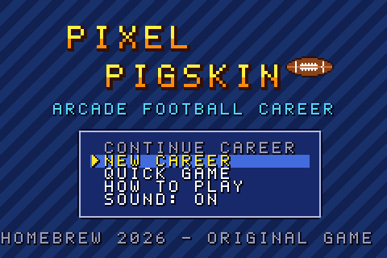
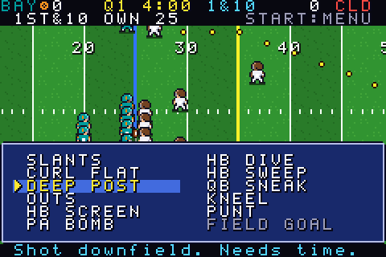
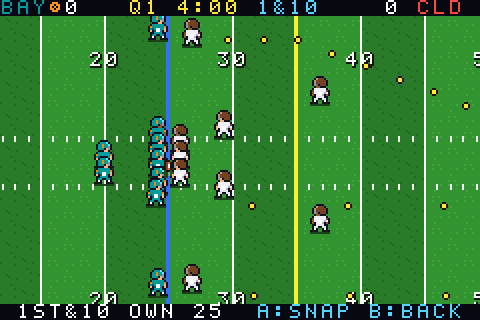
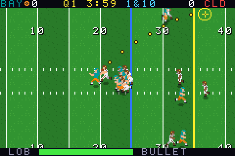
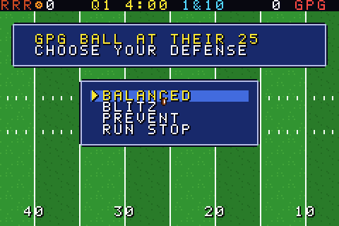
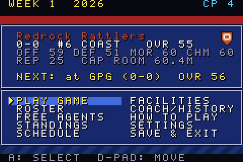
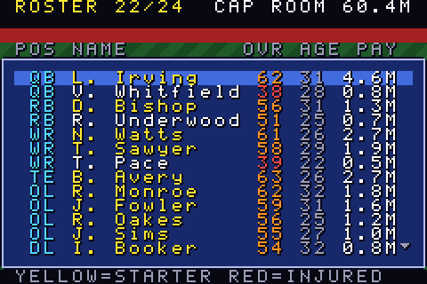
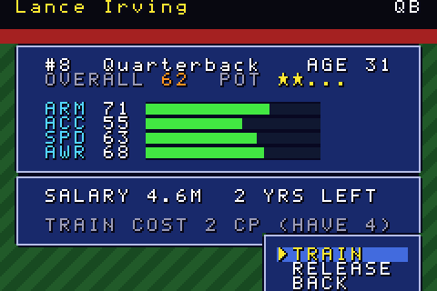
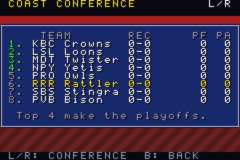

# Pixel Pigskin — an arcade football career for Game Boy Advance

**ROM:** [`gba/build/RetroFootball.gba`](build/RetroFootball.gba)

Pixel Pigskin is an original American football game built as a real Game Boy Advance ROM. It's a homebrew written in C for the GBA's ARM7TDMI CPU, and it runs in the **Delta** emulator on iPhone and iPad, in mGBA, and in other GBA emulators.

You call plays, aim and throw every pass, and steer every ball carrier. The CPU's possessions are simulated, but you pick the defensive call for each one. Between games you run the franchise: roster, salary cap, contracts, training, facilities, draft, free agency, playoffs and the **Gold Helmet** championship. The career goes on for as many seasons as you want.

The game takes its inspiration from short-session arcade football career games. Its name, teams, players, music, menus and code are original.

**Credits:** player sprites by **JordanTRS** (`assets/players_jordantrs.png`, credit required by the author). The UI art, field, ball, trophy and font are original to this project.

| | | |
|---|---|---|
|  |  |  |
|  |  |  |
|  |  |  |

---

## Playing it in Delta (iPhone / iPad)

1. **Copy the ROM to the device.** Send `RetroFootball.gba` to your iPhone or iPad by AirDrop, iCloud Drive, the Files app or email. Save it somewhere in **Files**.
2. **Import it.** Open Delta, tap **+** (top right), choose **Files**, and pick `RetroFootball.gba`. You can also tap the file in the Files app and choose **Share → Delta**.
3. **Play.** Tap the game in your Delta library. Turn the device to landscape for the biggest picture. Delta's on-screen GBA controller has every button the game uses: D-pad, A, B, L, R, START and SELECT.
4. **Saving.** The game uses **battery-backed SRAM (32 KB)**. Delta detects this automatically from the ROM, and the ROM contains the standard `SRAM_V113` marker. You don't need to change any settings.
   - The game **saves automatically** after every game, every roster or facility change, and every offseason step. *SAVE & EXIT* in the career menu also saves.
   - Delta writes the battery save to its own storage. To be safe, let the game sit for a second after a save, then go back to Delta's library before you force-quit the app.
   - Delta's *save states* also work, but they are separate from the in-game career save. The career always loads from the battery save.
   - To back up your career, long-press the game in Delta and export the save file (`.sav`, 32 KB).
5. **No BIOS needed.** The ROM has a valid cartridge header, Nintendo logo block and checksum, so it also boots with a real GBA BIOS and on flash carts.

> **Testing note:** I validated the ROM in **mGBA 0.10** (libmgba), using an automated headless harness. I couldn't launch Delta itself from the development environment, so the Delta steps above haven't been tried on a device. Delta's GBA core detects SRAM from the same ROM marker that mGBA reports as "Detected SRAM savegame".

---

## Controls

| Button | Menus | Passing play (before the throw) | Ball carrier |
|---|---|---|---|
| D-pad | Move cursor | Move the QB in the pocket. While aiming, nudge the target | UP/DOWN steer, LEFT cuts back, RIGHT is full speed. The runner moves upfield on his own |
| A | Confirm | Snap. **Hold** to aim (time slows, the power meter fills), **release** to throw | Juke |
| B | Back / cancel. Before the snap: audible (3 per game) | Throw the ball away | Dive |
| L / R | Switch conference (standings) | Cycle the target receiver | R: stiff arm |
| START | Pause (before the snap), confirm lists | — | — |
| SELECT | Open the roster from free agency / draft | — | — |

The game also has a 4-page **HOW TO PLAY** guide, on the title screen, in the career menu and in the pause menu.

### On the field
- **Play calling (Retro Bowl style):** the coach calls every play for you, based on down, distance, field position and the clock. The play's name shows at the top, and dotted lines preview each receiver's route. Press **A** to snap.
- **Audibles:** press **B** before the snap to audible to any play in the 10-play playbook: Slants, Curl Flat, Deep Post, Outs, HB Screen, PA Bomb, HB Dive, HB Sweep, QB Sneak or Kneel. You get **3 audibles per game**. The counter is shown at the top right, and B cancels without spending one.
- **4th down:** you choose **GO FOR IT**, **PUNT** or **FIELD GOAL**. A punt is greyed out inside the opponent's 40, and a field goal is greyed out beyond 70 yards. After a touchdown, you choose the extra-point kick or a 2-point try.
- **Passing:** **L/R** chooses the target. A green arrow means he's open, red means he's covered. **Hold A** to aim. The game runs in slow motion while a reticle and an arc show where the ball will land, and the meter fills from **LOB** to **BULLET**. Lobs float over coverage but take longer. Bullets arrive fast but are harder to catch and slightly less accurate. QB accuracy and arm strength, pressure, moving while throwing, and distance all add error. Defenders break on the ball and can deflect it or intercept it. Receivers can make contested catches and the occasional diving catch.
- **Running:** blockers engage defenders and defenders take pursuit angles. Speed and agility decide who breaks tackles. Juke, dive and stiff arm each have a cooldown.
- **Kicking:** press A to stop the power meter, then press A again when the aim arrow is in the green zone. The zone gets narrower on longer kicks and is wider for accurate kickers. Overpowering a kick hooks it.
- **Defense:** before each CPU drive, choose **BALANCED, BLITZ, PREVENT or RUN STOP**. The drive then plays out as a play-by-play log. Hold B to fast-forward.
- **Rules:** 4 downs to make 10 yards, touchdowns, an extra point or a 2-point try from the 2, field goals, punts, safeties, turnovers on downs, interceptions (including pick-sixes) and fumbles. The game also has kickoffs and touchbacks, a running clock with runoff between plays and a two-minute warning, halftime with the second-half kickoff, and sudden-death overtime. Regular-season games can end in a tie after one OT period. Playoff games always produce a winner. The scoreboard shows the score, quarter, clock, possession, and down and distance.

---

## Career mode

1. **NEW CAREER:** enter a coach name, choose one of 16 teams (each shows overall/offense/defense ratings and cap room), and choose a difficulty: Rookie, Pro or Legend. If a career already exists, the game asks you to confirm twice before it replaces it.
2. **The hub:** play your next game, or simulate it. You can also open your roster, free agents, standings, schedule (A shows any week's league results), facilities, coach career and history, how to play, and settings (quarter length 3–6 minutes, sound, difficulty). *SAVE & EXIT* returns to the title screen.
3. **Roster** (max 24 players, 19 starting slots): see each player's position, rating, age and salary. Starters are shown in yellow and injured players in red. Each player card shows attributes, potential stars, contract and injury status. From the card you can:
   - **TRAIN** a player, which spends coach points to raise his key attributes. You can train each player once per week, up to his potential.
   - **RELEASE** a player. This hurts team chemistry.
   - If you have no healthy player for a starting slot, a weak generic reserve fills in.
4. **Salary cap: $90.0M.** Every contract has a salary and a number of years. Free agents set their asking price from their rating, your reputation and your stadium level. Stars won't sign with a coach whose reputation is too low.
5. **Coach points (CP)** come from wins, playoff wins and season results. Spend them on training, a team dinner (+morale), or **facilities**:
   - Training: faster growth.
   - Rehab: shorter injuries.
   - Scouting: better draft potential.
   - Stadium: home edge, morale, and cheaper free agents.
6. **Morale and chemistry** change with wins, losses and roster moves, and they shift your team's ratings a little.
7. **Season:** 15 games, a full round robin across two conferences of 8. The top 4 in each conference make the playoffs. The playoff rounds are the Divisional round, the Conference Final, and the **Gold Helmet Game**, which comes with a trophy screen. The CPU simulates every other game in the league. Injuries happen in your games and in simulated games.
8. **Offseason:**
   - A season recap, with your reputation and CP awards.
   - Aging, development and retirements across the whole league.
   - **Expiring contracts:** re-sign or let go. Unhappy stars may refuse to re-sign.
   - A 2-round **draft** in reverse order of the standings. You pick when you're on the clock.
   - **Free agency.**
   - The new season.
9. **Coach career:** your record, playoff record, appearances, titles, reputation, best season, total yards, and a history of every past champion alongside your finish that year.
10. **Getting harder:** the CPU defense gets smarter as your career goes on and in the playoffs. On higher difficulties it adapts to your play calling, playing more zone if you keep throwing deep and blitzing more if you keep running. CPU teams also draft and sign players to keep up.

**QUICK GAME** plays a single exhibition between any two teams and never changes your save. If you leave the title screen alone for 20 seconds, a **demo** starts: the CPU plays a full game, and pressing any button returns to the title.

---

## Building from source

Requirements:
- `arm-none-eabi-gcc` with newlib targeting ARMv4T. The Ubuntu/Debian `gcc-arm-none-eabi` + `libnewlib-arm-none-eabi` packages work, and so does devkitARM.
- `make`
- `python3`

The project doesn't use libgba or any other external GBA library. It has its own `crt0.s`, linker script and hardware header.

```sh
sudo apt-get install gcc-arm-none-eabi libnewlib-arm-none-eabi make python3
cd gba
./build.sh            # -> build/RetroFootball.gba
```

`make` runs three steps:
1. `tools/gen_assets.py` converts the ASCII-art assets in `assets/` into tile data (`src/gen_assets.c`). If you change the player sheet, re-run `python3 tools/import_sheet.py` first (it needs Pillow).
2. The C sources are compiled for Thumb.
3. `tools/gbafix.py` writes the cartridge header (logo, title `PIXELPIGSKIN`, code `PXPE`, checksum).

### Tests
```sh
make test       # host: rules, simulator, 12-season career, save round-trip/corruption, 2,700 on-field plays
sudo apt-get install libmgba-dev python3-pil   # optional, for emulator tests
make romtest    # headless mGBA: smoke run, full season + offseason, demo game, 120k frames of random input
```
`make romtest` watches the game's frame counter and fails if the game hangs. It writes screenshots to `build/screens/`. The build also uses `-fstack-protector-strong`: if memory corruption is ever detected, the game stops on an error screen instead of misbehaving.

---

## Project layout

```
gba/
  build.sh, Makefile, gba.ld        build
  assets/font.txt, sprites.txt      original UI/field pixel art (ASCII grids)
  assets/players_jordantrs.png      player sprite sheet by JordanTRS (source)
  assets/players.txt                player frames cut from the sheet (generated)
  tools/import_sheet.py             sheet -> players.txt (frame list, colour keys)
  tools/gen_assets.py               asset converter (+ PNG previews with --preview DIR)
  tools/gbafix.py                   cartridge header fixer
  tools/mgba_runner.c, romtest.sh   headless emulator test harness
  tests/test_logic.c, test_play.c   host-side unit/integration tests
  tests/rom/*.txt                   scripted emulator sessions
  src/
    crt0.s          startup, header, IRQ handler
    gba.h, types.h  hardware registers
    main.c          entry point
    gfx.c           video: layers, palettes, text, panels, sprites, streamed scrolling field
    input.c         pad state, key repeat
    sound.c         PSG sound effects + music sequencer (original tunes)
    ui.c            menus, dialogs, text entry
    screens.c       title, career hub, roster, FA, standings, schedule, draft, offseason...
    match.c         a full game: camera, HUD, play calling, kicking, opponent drives
    play.c          on-field engine: routes, coverage AI, blocking, passing physics, tackling
    playbook.c      formations, routes, plays
    rules.c         downs, scoring, possession, clock, overtime (shared by play and sim)
    sim.c           statistical play simulator (CPU drives, other league games)
    league.c        players, ratings, lineups, contracts
    season.c        schedule, standings, playoffs, weekly upkeep
    offseason.c     aging, retirement, re-signing, draft, free agency
    save.c          SRAM save (two checksummed copies)
    data.c          teams, positions, name lists
    panic.c         stack-protector error screen
```

Gameplay logic (`play`, `rules`, `sim`, `league`, `season`, `offseason`, `save`) doesn't touch the hardware, so the host tests compile and run those same files.

## Technical notes

- **Display:** Mode 0.
  - BG0 is text, BG2 is panels, BG1 is the field or menu backdrop.
  - The field map is 104×32 tiles, generated from about 100 cached tiles. It streams into a 64×32 background as the camera scrolls.
  - Players are 32×32 sprites with 32 animation frames: stand, a 6-frame run, a 6-frame run with the ball, aim, throw, jump catch, fall, down, wrestle (blocking), dive, stiff arm, kneel and celebrate. The sheet uses key colours, which become palette indices. Each team gets home colours or away whites, with two skin tones and ground shadows.
- **Performance:** a live play uses at most about 150 of the 228 scanlines in a frame, roughly 65% CPU at 60 fps (measured in mGBA). The ROM is about 100 KB, and the RAM footprint is about 4 KB IWRAM and about 27 KB EWRAM.
- **Save:** the 8.8 KB career block is written twice (slots at 0x0000 and 0x4000). Each copy has a version, a size, a save counter and a checksum. On load the game takes the newest valid copy, so a torn or corrupted write can't destroy the career. All SRAM access is 8-bit, as the hardware requires.
- **Audio:** all sound uses the PSG channels, with no DMA. Square channel 2 and the noise channel play effects (snap, throw, catch, tackle, whistle, first down, touchdown fanfare, kick, good/no good, turnover, crowd). Square channel 1 and the wave channel play music: a title theme, a hub theme, and victory, defeat and championship jingles.

## Features and limitations

**Implemented:** everything described above.

**Limitations and simplifications:**
- You play offense only. Defense is a play-calling choice, and the CPU's drives are simulated play by play. This is by design, as in other arcade career football games.
- Kickoffs and punt returns are resolved automatically.
- The game has no timeouts and no penalties. Instead, the clock automatically hurries up when you're trailing late, and runs down when you're leading.
- Each team uses the same 9-on-9 formation family (QB, RB, 2 WR, TE, 4 OL against 3 DL, 2 LB, 4 DB). It isn't 11-on-11, so the field stays readable at 240×160.
- The depth chart is automatic: the best healthy player starts at each position.
- Stats are tracked per team and per season for your team, plus career totals for the coach. Individual player season stats aren't tracked.
- Contract lengths for signings are set by the player's age and rating. You can't negotiate them.
- The game was tested in mGBA, through a headless harness with scripted and random input. It hasn't been tested on Delta or on GBA hardware.
